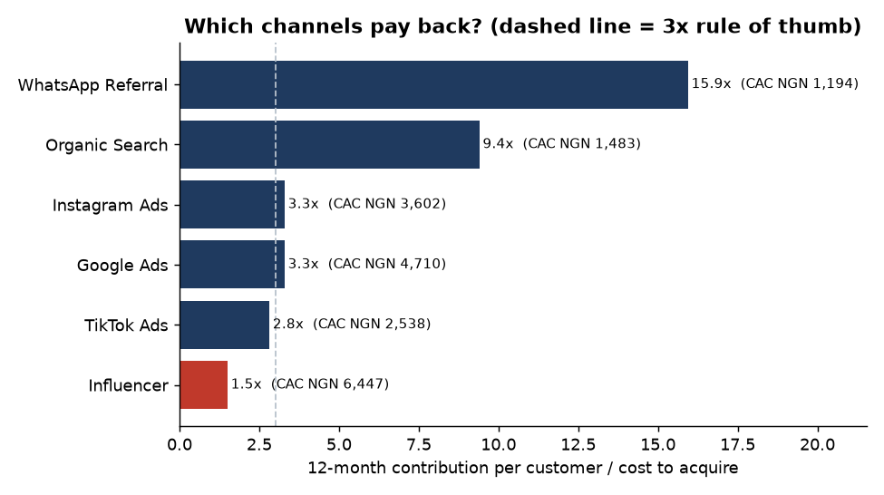
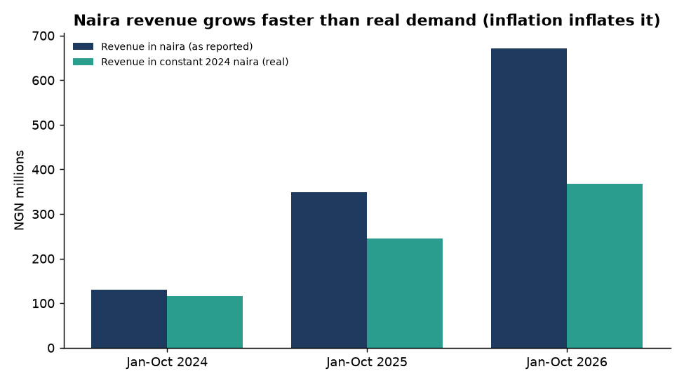
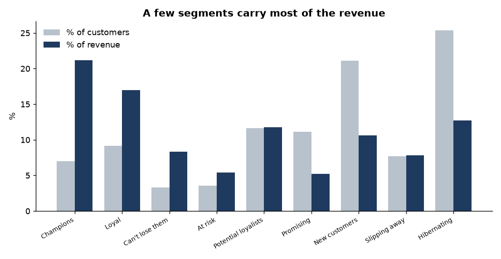
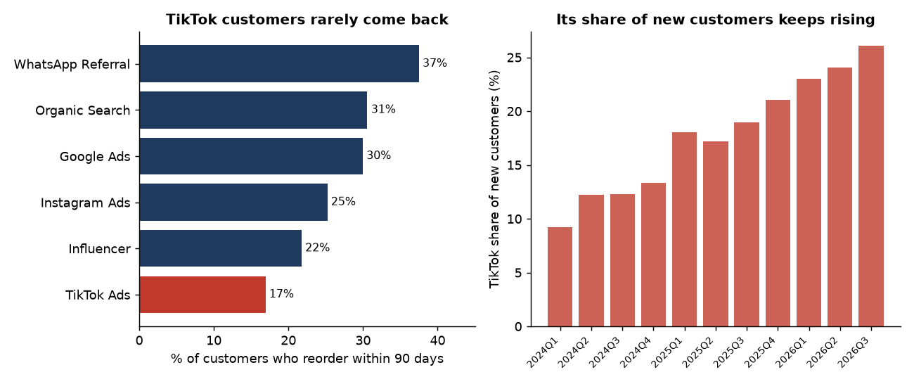
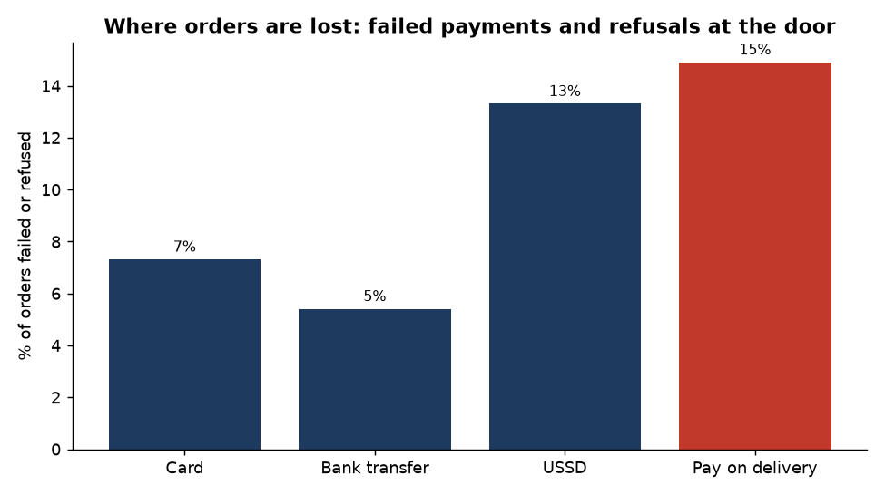
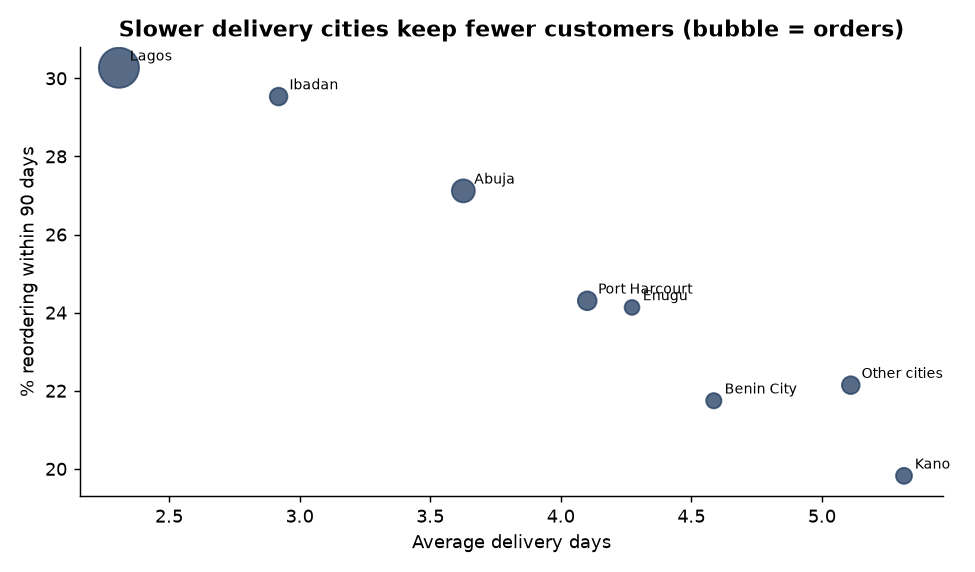
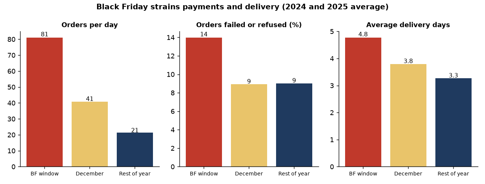

# The Black Friday Playbook: Customer, Marketing and Delivery Analytics for a Nigerian E-commerce Retailer

**Analyst:** [Nuelwumi2024](https://github.com/Nuelwumi2024) · **Tools:** Python (pandas, Matplotlib), Power BI (DAX), SQL-style analysis · **Period:** Jan 2024 to Oct 2026

> **Disclaimer:** *Adire Market* is a **fictional** company and all data is **synthetic** (seeded and reproducible with `src/generate_data.py`). The story is invented, but the metrics, methods and operating conditions (naira inflation, pay on delivery, USSD payments, city logistics, Black Friday) are real-world. This is a portfolio case study, not a real engagement.

> **Status:** the Python analysis, cleaned tables, DAX measures and a page-by-page Power BI build guide are complete. See [section 8](#8-power-bi-report) for the report layout.



---

## Executive summary

**The situation:** Black Friday is four weeks away (27 November 2026). Last year it was Adire Market's biggest week. But did it make money, and who should the business spend its marketing naira on?

**The answers:**

| Question | Answer |
|---|---|
| **Is our growth real?** | Partly. Naira revenue grew **92%** (Jan to Oct, 2026 vs 2025), but in constant 2024 naira the growth was **50%**. The gap is inflation: average order value rose 27% in naira. |
| **Who are our customers?** | **Champions are 7% of customers but 21% of revenue.** The top 10% of customers deliver 35% of revenue. 956 "at risk" and "can't lose them" customers hold 14% of past revenue and are ready for a win-back campaign. |
| **Which channels pay back?** | **WhatsApp referral (15.9x) and organic search (9.4x)** pay back best. **Influencers (1.5x)** barely do. **TikTok** is cheap to acquire but only **17% of its customers reorder within 90 days**, and its share of new customers has nearly tripled. |
| **Where do we lose orders?** | **9.3% of orders (₦144M of order value)** are lost to failed payments (USSD fails 13% of the time) and refusals at the door (pay on delivery: 15%). Slow delivery cities keep fewer customers. |
| **Did Black Friday make money?** | **No.** In the 11-day window, orders run 3.8x normal, but the average discount is 25% and the **contribution margin is -6%** (against +17% the rest of the year). Groceries, Electronics and Phones lose money outright. Capping discounts at 15% would have turned last year's window from a ₦2.1M loss into a ₦2.5M profit. |

---

## 1. The story

**Adire Market** (fictional) is a Lagos-based online marketplace selling fashion, phones and accessories, beauty, home and kitchen, groceries and electronics to customers in eight cities: Lagos, Abuja, Ibadan, Port Harcourt, Kano, Enugu, Benin City and others. It acquires customers through six channels (organic search, WhatsApp referrals, Instagram, TikTok, Google and influencers) and delivers by courier. Customers pay by card, bank transfer, USSD, or cash on delivery.

It is **1 November 2026**. I have just joined as **Customer and Marketing Analyst**. The founder calls a meeting:

> *"Last year's Black Friday was our biggest week ever, and I want it bigger this year. But finance says we have sold a lot and kept very little. Before I approve the discount budget and the marketing plan: are we actually growing, who are our best customers, where is our marketing money working, and where are we losing orders? And did last year's Black Friday make money?"*

The business had grown fast: **31,247 orders from 14,811 customers in 34 months**. But nobody had looked at quality: who buys again, which channel's customers stay, or what a 25% discount really costs once you count delivery and failed payments. This project is that look.

## 2. Business questions

1. **Growth:** how much of the naira growth is real, and how much is inflation?
2. **Customers:** who are our best customers, and who are we about to lose?
3. **Marketing:** which channels pay back, and which just add volume?
4. **Operations:** where do orders fail, and does delivery speed affect loyalty?
5. **Black Friday:** does the biggest week of the year make money, and how do we plan this year's?

## 3. The data

| Table | Rows | What it holds |
|---|---|---|
| `orders` | 31,247 | One row per order: customer, city, device, channel, category, units, price, discount, payment method, outcome, delivery days, revenue, cost and contribution |
| `customers` | 14,811 | Acquisition channel, city, device, first order date |
| `marketing_spend` | 204 | Monthly spend and new customers by channel |
| `funnel` | 102 | Monthly sessions, add-to-cart, checkout and orders by device |
| `price_index` | 34 | A monthly price index (about 28% inflation a year), used to convert naira to constant prices |

**Key definitions**
- **Realised revenue:** the value of *delivered* orders. Cancelled, refused and returned orders earn nothing.
- **Contribution:** realised revenue minus product cost and delivery cost. Refused and returned orders cost delivery both ways.
- **Constant naira (real):** revenue divided by the price index, so 2026 and 2024 can be compared fairly.

## 4. The analysis

### 4.1 Is the growth real? Strip out inflation



Jan to Oct 2026 revenue was **₦672M against ₦349M** in 2025 (+92%). It looks like a rocket. But prices rose about 28% over the year, and the average order value rose 27% in naira. In constant naira the growth was **+50%** (orders +52%). That is still strong, but roughly half the headline rate. International readers will recognise this as a constant-currency view: it stops inflation from flattering the numbers.

### 4.2 Who are our customers? (RFM segmentation)



I scored every customer on **Recency** (days since last delivered order), **Frequency** (delivered orders) and **Monetary value** (constant naira), then grouped them into segments.

- **Champions: 7% of customers, 21% of revenue.** The top 10% of customers deliver 35% of revenue, and the top 20% deliver 54%.
- **"At risk" and "Can't lose them": 956 customers holding 13.7% of past revenue** (about ₦117M in constant 2024 naira, averaging ₦122,616 each). They bought often and have gone quiet.
- **Hibernating: 25% of customers** but only 13% of revenue. They bought once, long ago.

### 4.3 Which marketing channels pay back?


For each channel I compared the **cost to acquire a customer (CAC)** with the **12-month contribution that customer generates** (customers with a full year of history).

| Channel | CAC | 12-month contribution / CAC | Reorder within 90 days |
|---|---|---|---|
| WhatsApp referral | ₦1,194 | **15.9x** | 37% |
| Organic search | ₦1,483 | 9.4x | 31% |
| Google Ads | ₦4,710 | 3.3x | 30% |
| Instagram Ads | ₦3,602 | 3.3x | 25% |
| TikTok Ads | ₦2,538 | 2.8x | **17%** |
| Influencer | ₦6,447 | **1.5x** | 22% |



- **Influencers barely pay back** and cost the most per customer.
- **TikTok looks efficient (low CAC) but its customers rarely come back.** And its share of new customers has risen from **9% in early 2024 to 26% in Q3 2026**. The business is buying volume that does not stick.
- **Blended CAC rose from ₦2,556 (2024) to ₦3,273 (2026), up 28%.**
- *Illustration:* moving a quarter of influencer spend (₦2.1M) to Google Ads at each channel's average payback would add about **₦3.7M** of 12-month contribution, before any diminishing returns.

### 4.4 Where do we lose orders?



**9.3% of orders (2,918) and ₦144M of order value are lost** to failed payments and refusals at the door.
- **USSD:** 13% of orders fail at payment.
- **Pay on delivery:** 15% are refused when the courier arrives. It accounts for **39% of the lost value**.
- Cards fail 7% of the time, bank transfers 5%.



Delivery speed varies from **2.3 days in Lagos to 5.3 days in Kano**, and the slowest cities keep the fewest customers: **30% of Lagos customers reorder within 90 days, against 20% in Kano.** This is a correlation, not proof that speed alone causes it, but it points at courier capacity outside Lagos.

### 4.5 Did Black Friday make money?



| 2024 and 2025 average | Black Friday window (20-30 Nov) | December | Rest of year |
|---|---|---|---|
| Orders per day | **81 (3.8x)** | 41 | 21 |
| Average discount | **25%** | 10% | 3% |
| Orders failed or refused | **14%** | 9% | 9% |
| Average delivery days | **4.8** | 3.8 | 3.3 |
| **Contribution margin** | **-6%** | 11% | **17%** |

Black Friday brings the volume and loses money. The problem is **category**, because the same 25% discount means very different things at different margins:

| Category | Contribution margin, normal days | Contribution margin, Black Friday window |
|---|---|---|
| Beauty | 31% | 10% |
| Fashion | 29% | 8% |
| Home and kitchen | 23% | 2% |
| Phones and accessories | 14% | **-11%** |
| Electronics | 7% | **-19%** |
| Groceries | 5% | **-22%** |

**If last year's window had capped discounts at 15%** (and sales volume had held), contribution would have moved from **-₦2.1M to +₦2.5M**. In practice some demand would drop, so I would test it rather than assume it.

## 5. What I would tell the founder

> *"Black Friday will give you volume and take your margin unless we change the plan. The growth is real, but about half the headline rate. Your best customers are few and easy to lose. Referral and organic carry your business; influencers and TikTok do not. And roughly one order in ten never completes."*

## 6. Recommendations: the Black Friday playbook

| # | Action | Evidence |
|---|---|---|
| 1 | **Cap Black Friday discounts at 15%, and exclude groceries, electronics and phones from deep cuts** | These categories lose 11% to 22% at a 25% discount. A 15% cap turns last year's window from loss to profit |
| 2 | **Win back the 956 at-risk customers by WhatsApp before Black Friday** | They hold 14% of past revenue and know the brand |
| 3 | **Push card and bank transfer, and add a small incentive for paying upfront instead of pay on delivery** | Pay on delivery causes 39% of lost value (15% refused at the door) |
| 4 | **Fix the USSD payment flow** and add a retry option | 13% of USSD orders fail |
| 5 | **Add courier capacity outside Lagos (Kano, Port Harcourt, Enugu, Benin) and pre-position stock** | Delivery takes up to 5.3 days and loyalty falls with it; Black Friday adds a further 1.5 days |
| 6 | **Expand the WhatsApp referral programme and cut influencer spend** | Referral pays back 15.9x; influencers 1.5x |
| 7 | **Judge TikTok on repeat purchase, not CAC,** and cap its share of acquisition budget | Only 17% of its customers reorder |

## 7. Limitations (read before quoting a number)

- **The data is synthetic.** I generated it with built-in patterns, so this shows method and storytelling, not real company results.
- **Contribution excludes overheads, marketing for existing customers and taxes.**
- **The 12-month contribution uses customers acquired at least a year before the end of the data.** Recent customers are not yet included.
- **Delivery and loyalty are correlated, not proven to be cause and effect.**
- **The discount-cap and budget-shift figures hold volume constant** and ignore diminishing returns, so they are estimates to test, not forecasts.
- **Inflation is a synthetic index** (about 28% a year) for demonstration.

## 8. Power BI report

The cleaned tables and DAX are ready. Load the files in `data/raw/` and `data/processed/customer_segments.csv`, then build a four-page report.

**Model:** `customers` (1) → `orders` (many) by `customer_id`; `customers` (1) → `customer_segments` (1); `DateTable` → `orders[order_date]`, `marketing_spend[month]`, `funnel[month]`; `Channels` (calculated) → `customers[acquisition_channel]` and `marketing_spend[channel]`; `price_index[month]` → `orders[Month]`. All measures are in [`dax/measures.dax`](dax/measures.dax).

| Page | Purpose | Visuals |
|---|---|---|
| **1. Growth** | Is the growth real? | Cards (revenue, real revenue, orders, AOV); line of naira vs constant-naira revenue by month; YoY cards; slicers for year, city and channel |
| **2. Customers** | Who matters? | Segment bar chart (customers vs revenue); treemap of revenue by segment; Pareto of top customers; table of the win-back list |
| **3. Marketing** | Which channels pay back? | Bar of LTV:CAC by channel; scatter of CAC vs repeat rate; stacked column of new customers by channel; CAC trend |
| **4. Operations and Black Friday** | Where is money lost? | Orders failed or refused by payment method; map or bar of delivery days by city; funnel by device; Black Friday margin by category; **what-if slider for the discount cap** |

## 9. Skills demonstrated

| Area | Evidence |
|---|---|
| **Customer analytics** | RFM segmentation, concentration, win-back targeting |
| **Marketing analytics** | CAC, 12-month contribution, LTV:CAC, repeat rate by channel |
| **Commercial thinking** | Contribution margin, discount economics, budget reallocation |
| **International-standard practice** | Constant-currency view of an inflationary market |
| **Operations analytics** | Payment failure, refusal and delivery analysis |
| **Python** | Data simulation, pandas analysis, Matplotlib charts, reproducible scripts |
| **Power BI** | Star-schema model, DAX measures, what-if parameter |
| **Storytelling** | A founder's question, answered in order, ending in a costed plan |

## 10. Repository

```
data/raw/        synthetic CSVs (orders, customers, marketing_spend, funnel, price_index)
data/processed/  analysis outputs, incl. customer_segments.csv for Power BI
dax/             measures.dax
figures/         charts used above
src/             generate_data.py, analysis.py
theme/           playbook-theme.json (Power BI theme)
```

```bash
pip install pandas numpy matplotlib
python src/generate_data.py   # regenerates the data
python src/analysis.py        # writes data/processed/*.csv and figures/*.png
```

---

Built by **[Nuelwumi2024](https://github.com/Nuelwumi2024)**. See also: [Atlas Global Retail profit case study](https://github.com/Nuelwumi2024/powerbi-global-superstore-analysis) · [HR attrition case study](https://github.com/Nuelwumi2024/powerbi-hr-attrition-dashboard) · [Hospital readmissions analysis](https://github.com/Nuelwumi2024/hospital-readmissions-analysis) · [Portfolio](https://nuelwumi2024.github.io/)
